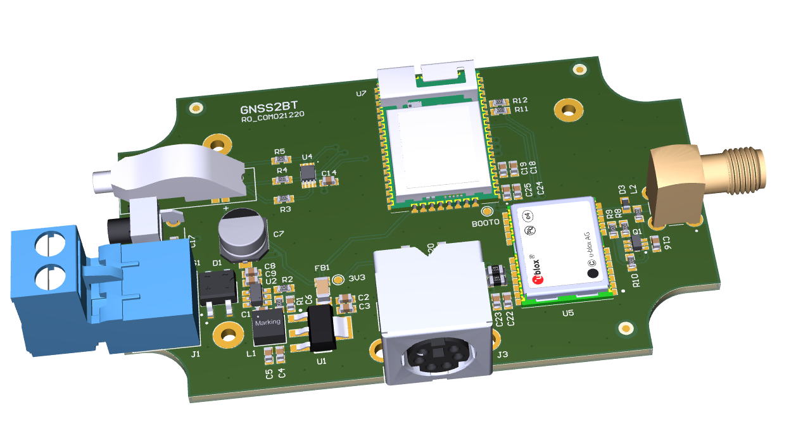
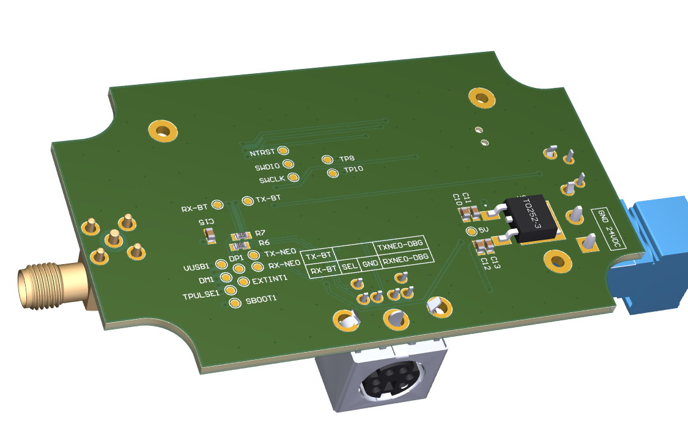
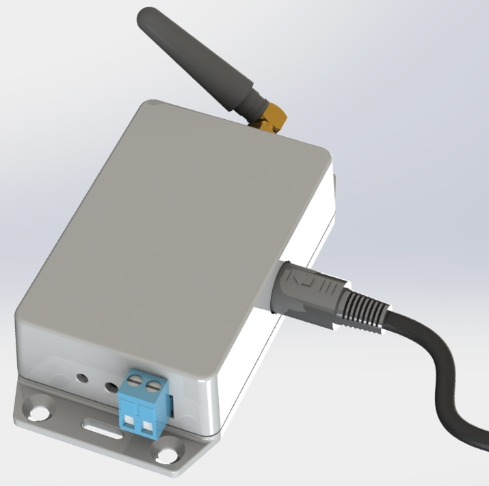
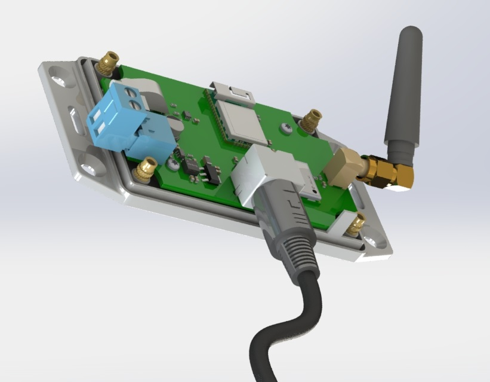
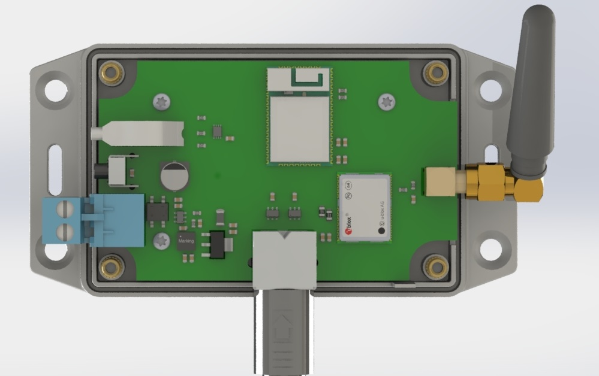
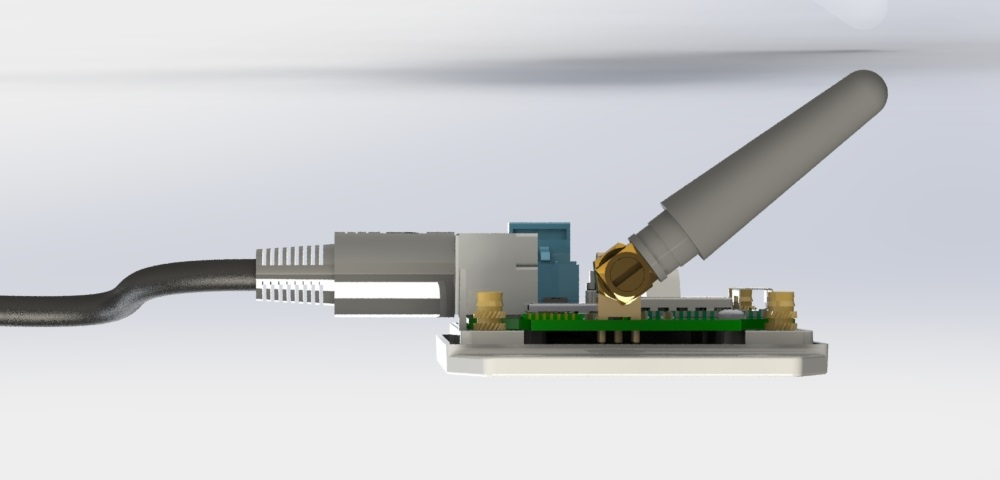
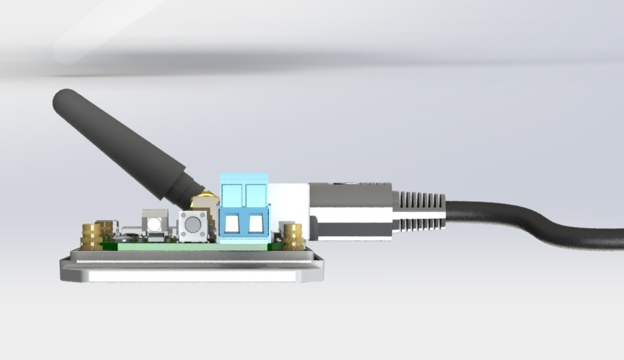
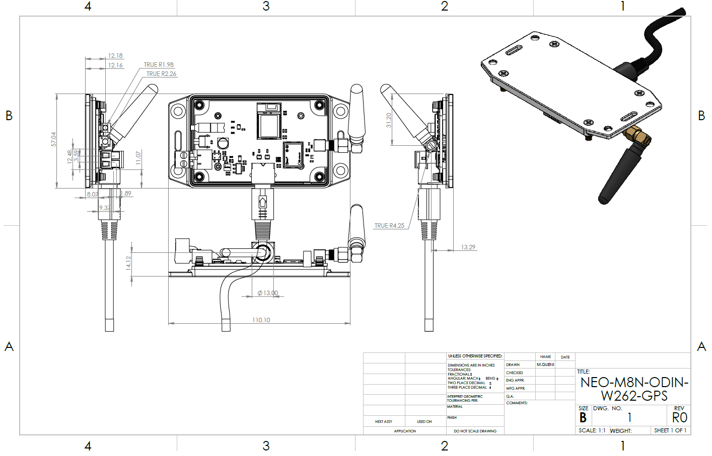

# GNSS to Bluetooth Module (NEO-M8N + ODIN-W262)

Board `GNSS2BT` (R0) combines a u-blox NEO-M8N GNSS receiver with a u-blox
ODIN-W262 Bluetooth / Wi-Fi module. It runs from a 24 VDC terminal block and sits
in a flanged Hammond 1591 enclosure modelled in SolidWorks. A 6-pin Mini-DIN
(PS/2 style) connector brings out the UARTs and a `SEL` line that switches the
serial routing, so the module can be configured or reprogrammed without opening
the enclosure.

| Top | Bottom |
| --- | --- |
| [](images/pcb-3d-top.png) | [](images/pcb-3d-bottom.png) |

| Enclosure, closed | Enclosure, open | Inside the enclosure |
| --- | --- | --- |
| [](images/enclosure-closed.jpg) | [](images/enclosure-open-3d-view.jpg) | [](images/enclosure-top-view.jpg) |

| Side view | Side view |
| --- | --- |
| [](images/enclosure-side-view-1.jpg) | [](images/enclosure-side-view-2.jpg) |

[](images/enclosure-assembly-drawing.png)

## On the board

| Ref | Part | Role |
| --- | --- | --- |
| U5 | NEO-M8N-0 | GNSS receiver |
| U7 | ODIN-W262-05B | Bluetooth / Wi-Fi module (SWD and BOOT0 on test points) |
| U6, U8 | SN74LVC1G3157 | Single analog switches that route the UARTs, controlled by `SEL` |
| U4 | SN74LVC3G07 | Triple open-drain buffer |
| D2 | 150141M173100 | RGB status LED (`RLED`, `GLED`, `BLED`) |
| J2, D3 | SMA connector + PESD0603-240 | Antenna connector with ESD protection |
| Q1 | MBT3906DW1T1G | Dual PNP transistor |
| L2 | L0603C27NJRMST, 27 nH | RF inductor |
| J1, D1 | 2-way 5.08 mm terminal block + MB6S bridge | 24 VDC input (either polarity) |
| U2, L1 | LMR50410 + 15 µH | Buck converter |
| U3 | BD50C0AFP | 5 V regulator |
| U1 | TLV1117LV33 | 3.3 V LDO |
| J3 | KMDGX-6S-BS, 6-pin Mini-DIN | Service connector: `TX-BT`, `RX-BT`, `TX-NEO-DBG`, `RX-NEO-DBG`, `SEL`, `GND` |
| S1 | 1825027-8 | Push button |

## Repository layout

```
0008_neo_m8n/
├── PCB/                              # Altium Designer project
│   ├── GNSS.PrjPCB                   # Project file (open this)
│   ├── GNSS_BLE.SchDoc               # Schematic
│   ├── GNSS_PCB.PcbDoc               # PCB layout
│   ├── GNSS.PCBDwf                   # Draftsman drawing
│   ├── GNSS.PrjPCBVariants           # Variants
│   ├── OutJob.OutJob                 # Output job
│   └── Project Outputs for GNSS/     # Generated BOM, Gerbers, PDFs and STEP
├── mechanical/                       # SolidWorks enclosure
│   ├── 1591XXMFLBK.SLDASM            # Enclosure assembly
│   ├── Assembly.SLDDRW               # Assembly drawing
│   ├── GNSS.SLDPRT                   # PCB model
│   ├── *.SLDPRT, *.SLDASM            # Connector, antenna, cable and screw models
│   └── drawings/                     # PDF export of the assembly drawing
└── images/                           # Renders used in this README
```

## Component library

This repo stores no libraries. Every part comes from the general Altium library
in [Gueni/0000_libraries](https://github.com/Gueni/0000_libraries):

| File | Used for |
| --- | --- |
| [`Altium/DATABASE.DbLib`](https://github.com/Gueni/0000_libraries/blob/master/Altium/DATABASE.DbLib) | Database library the schematic components link to |
| [`Altium/DB.mdb`](https://github.com/Gueni/0000_libraries/blob/master/Altium/DB.mdb) | Parts database (part numbers, MPNs, suppliers) |
| [`Altium/SCH.SchLib`](https://github.com/Gueni/0000_libraries/blob/master/Altium/SCH.SchLib) | Schematic symbols |
| [`Altium/FTP.PcbLib`](https://github.com/Gueni/0000_libraries/blob/master/Altium/FTP.PcbLib) | PCB footprints and 3D models |

### Setup

The project finds the library through a relative path, so clone both repos side
by side in the same workspace folder:

```
WORKSPACE/
├── 0000_libraries/                   # git clone https://github.com/Gueni/0000_libraries.git
└── 0008_neo_m8n/                     # this repo
```

The project file references `..\..\0000_libraries\Altium\DATABASE.DbLib` and
adds `..\..\0000_libraries\Altium\` as a library search path. The DbLib's
database path is absolute (`D:\WORKSPACE\0000_libraries\Altium\DB.mdb`); see the
[library README](https://github.com/Gueni/0000_libraries#setup) if your
workspace lives elsewhere.
